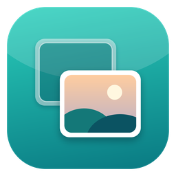
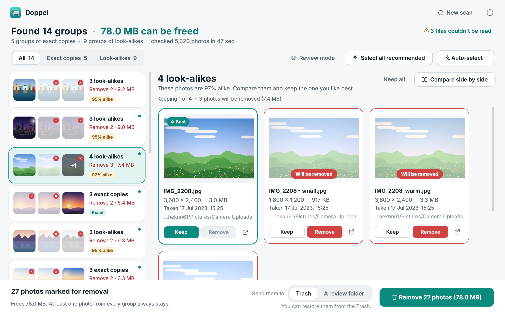
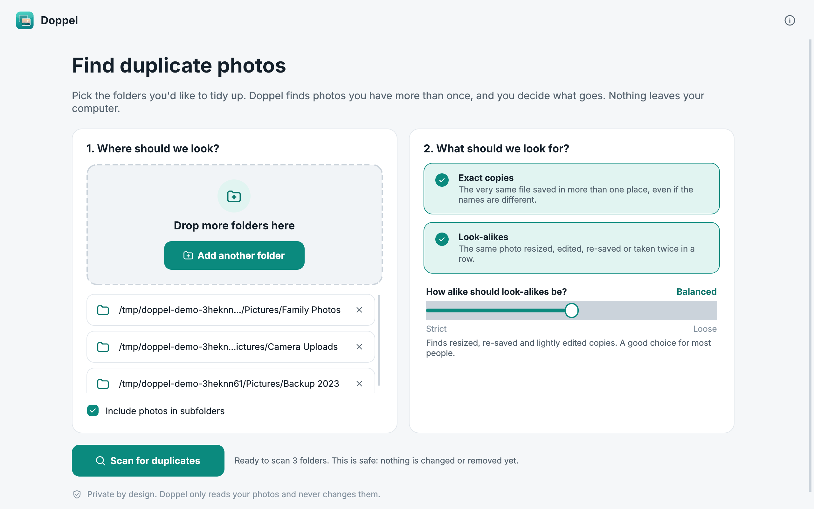
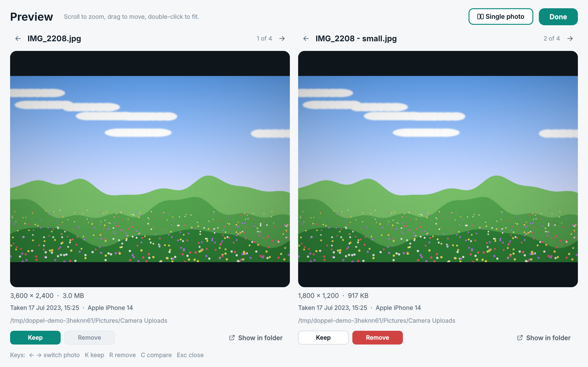

<p align="center">
  
</p>

<h1 align="center">Doppel</h1>

<p align="center">
  <b>Find duplicate and look-alike photos, and clean them up safely.</b><br>
  Free · Offline · Private · Windows, macOS and Linux
</p>

<p align="center">
  <a href="https://github.com/rishitmpatel/doppel/releases/latest"><b>Download</b></a> ·
  <a href="#how-it-works">How it works</a> ·
  <a href="#run-from-source">Run from source</a>
</p>



Phone backups, WhatsApp downloads, "Copy of IMG_2208.jpg", the same holiday folder copied to three drives… photo libraries fill up with duplicates. Most cleaners are paid, full of ads, or upload your photos somewhere. Doppel does it on your own computer, and nothing is deleted until you say so.

## What it finds

- **Exact copies**: the very same file saved in more than one place, even under a different name.
- **Look-alikes**: the same photo resized, re-saved by a messaging app, lightly edited, rotated, or taken twice in a row.

For every group Doppel suggests the best one to keep (highest resolution, sharpest, original-looking name) and lets you change it with one click.

## Safe by design

- **Nothing is permanently deleted.** Removed photos go to the Recycle Bin / Trash, or to a review folder you can browse first. Moves can be undone in the app.
- **At least one photo in every group always stays.** The app won't let you remove all of them.
- **Your originals are never modified.** Scanning only reads files.
- **No internet, no account, no tracking.** Your photos never leave your computer.

| Pick folders | Compare side by side |
|---|---|
|  |  |

## Download

Get the latest version from **[Releases](https://github.com/rishitmpatel/doppel/releases/latest)**:

| System | File | How to open |
|---|---|---|
| Windows 10/11 | `Doppel-Windows.zip` | Unzip, double-click `Doppel.exe`. If SmartScreen warns, click *More info → Run anyway* (the app isn't code-signed yet). |
| macOS 12+ | `Doppel-macOS.zip` | Unzip, drag `Doppel.app` to Applications. First launch: right-click → *Open* (not notarized yet). |
| Linux | `Doppel-Linux.tar.gz` | Extract and run `./Doppel`. Needs `libxcb-cursor0` on some distros. |

HEIC photos from iPhones are supported.

## How to use

1. **Choose folders** (or drag them in), e.g. your Pictures folder and a backup drive.
2. Pick what to look for: exact copies, look-alikes, or both. The *Strict ↔ Loose* slider controls how alike look-alikes must be. *Balanced* suits most people.
3. **Scan.** A rescan is almost instant, because Doppel remembers photos it has already checked.
4. Review the groups. The suggested keeper is marked **Best**; click *Keep* / *Remove* to change it. Use **Compare side by side** for a closer look.
5. **Remove**, and choose *Trash* or *A review folder*.

Keyboard: `↑ ↓` groups · `← →` photos · `K` keep · `R` remove · `Space` preview.

## How it works

No AI model and no cloud. Doppel uses classic, fast image fingerprinting:

1. **Exact copies.** Files are grouped by size, then by a quick hash of their first and last 64 KB, and only then fully hashed (BLAKE2b). Most files are ruled out without being read in full.
2. **Look-alikes.** Each photo is shrunk to a tiny grayscale image and turned into 64-bit *perceptual hashes* (a DCT-based pHash and a difference hash). Resizing, recompression, rotation and small edits barely change them, so similar photos have hashes that differ in only a few bits. Candidate pairs must agree on both hashes, plus a final structural check, so different photos with similar layouts (like screenshots of the same app) aren't confused.
3. **Choosing the keeper.** Resolution → sharpness (variance of the Laplacian) → file size → EXIF data → original-looking filename.

Results are cached in a small local database, so later scans only look at new or changed files. On a 2-core machine, 2,000 photos scan in about 5 seconds cold and 0.1 s warm.

## Run from source

```bash
git clone https://github.com/rishitmpatel/doppel
cd doppel
pip install -e ".[heic,dev]"
doppel                 # or: python -m doppel
python -m pytest -q    # engine + GUI tests (set QT_QPA_PLATFORM=offscreen on headless machines)
```

Build a standalone app yourself:

```bash
pyinstaller packaging/doppel.spec --noconfirm   # output in dist/
```

Releases are built automatically by GitHub Actions for all three platforms when a `v*` tag is pushed.

## Project layout

```
src/doppel/core/   scanning, hashing, grouping, keep rules, safe removal (no GUI code)
src/doppel/gui/    PySide6 desktop interface
tests/             engine and GUI tests
packaging/         PyInstaller build
```

## Known limitations

- Documents built from the same template that differ only in a few small numbers (e.g. two invoices) can look alike at thumbnail size. Always glance at look-alike groups of documents before removing.
- Look-alike matching is tuned for photos and screenshots; heavy crops (more than ~6% per side) of screenshots are not matched.
- Very large libraries (100k+ photos) work but the comparison step slows to tens of seconds.

## Roadmap

- Video duplicates
- "Similar scenes" mode for burst shots with a stricter quality pick
- Code-signed Windows and notarized macOS builds

## License

MIT
